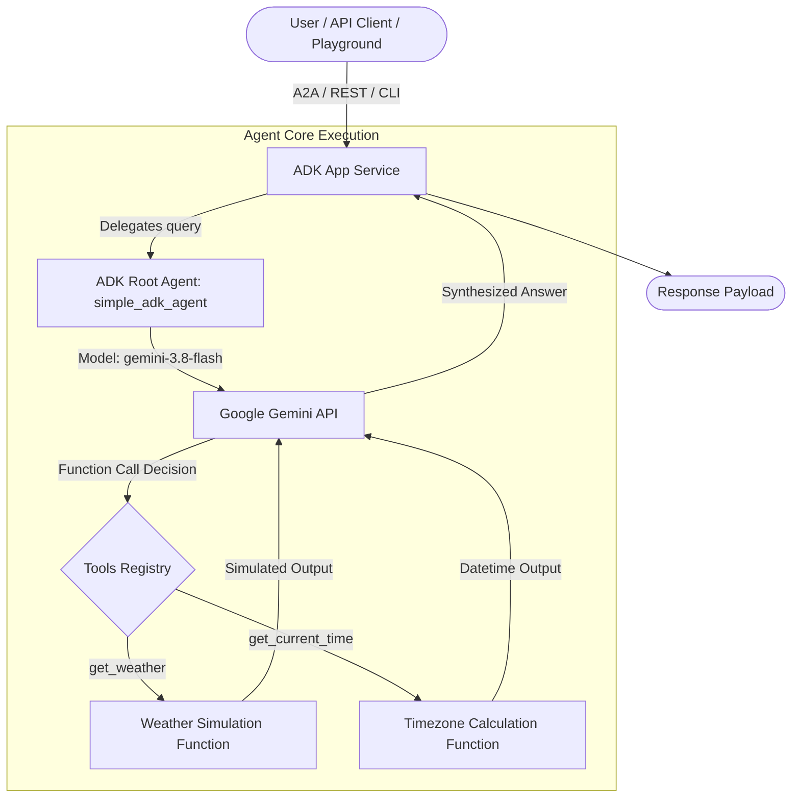

# Technical Design Document: Simple ADK Agent (`simple_adk_agent`)

## 1. System Overview & Architecture

The **Simple ADK Agent** is built using the **Google Agent Development Kit (ADK)** and scaffolded via `agents-cli`. It provides real-time query assistance with integrated function calling for weather retrieval and timezone-aware local time lookups.



---

## 2. Core Components & Technical Specifications

### A. Agent Definition (`app/agent.py`)
- **Framework**: Google Agent Development Kit (ADK) `google.adk.agents.Agent`.
- **Model**: `gemini-3.8-flash` with 3-attempt HTTP retry policy.
- **Tools**:
  - `get_weather(query: str)`: Provides simulated weather reports based on city query.
  - `get_current_time(query: str)`: Computes localized ISO timestamps using `zoneinfo.ZoneInfo`.

### B. FastAPI Serving (`app/fast_api_app.py`)
- **Web Server**: FastAPI served via Uvicorn.
- **Protocol**: Built-in Agent-to-Agent (A2A) protocol support and REST JSON endpoints.
- **Port**: Default port 8000.

---

## 3. API & CLI Interface Specifications

### A. Local CLI Execution via `agents-cli`
```bash
# Run single prompt smoke test
agents-cli run "What is the weather and current time in San Francisco?"

# Start web playground interface
agents-cli playground
```

### B. REST API Endpoint (`POST /`)
```json
{
  "prompt": "What is the time in SF?"
}
```

---

## 4. Evaluation & Testing Strategy
- **Behavioral Evaluation**: Executed via `agents-cli eval run` using LLM-as-judge scoring.
- **Dataset Location**: `tests/eval_dataset.json`.
